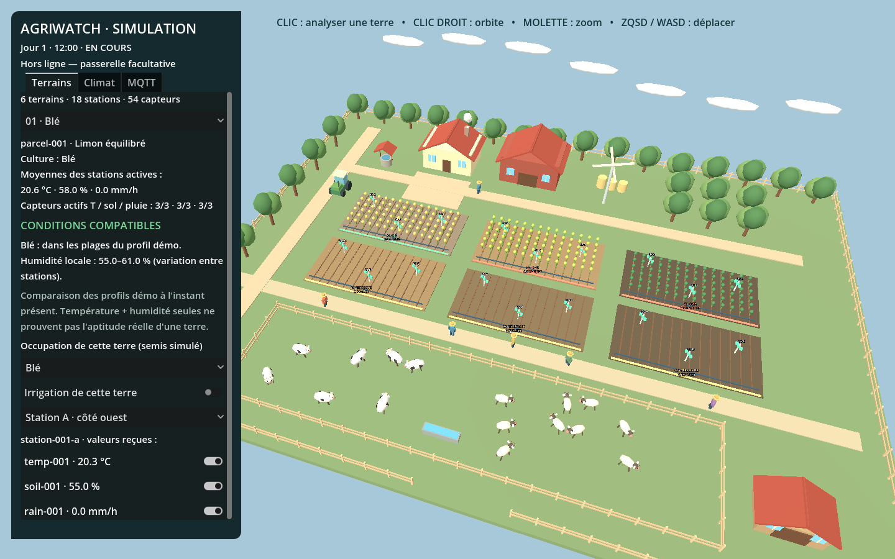

# AgriWatch Simulator

Ferme 3D autonome pour Godot 4, interface française, six terrains nus ou cultivés, 54 capteurs et télémétrie MQTT facultative. Aucun asset externe. Simulation simplifiée, pas un modèle agronomique validé. L’irrigation agit uniquement sur la ferme virtuelle.



La ferme comprend maintenant six parcelles réparties sur un domaine rural agrandi, une maison, une grange, un abri, un puits, un tracteur, un verger, des clôtures, six personnages, sept vaches et neuf moutons animés. Les déplacements décoratifs et la rotation de l’éolienne suivent le temps réel ; ils restent animés pendant la pause agricole. Les animaux suivent des parcours visuels dans leur pâturage, sans simulation de besoins ni collisions. La pluie visible suit les mesures simulées. `scripts/life.gd` contient cette vie décorative.

## Installation après clonage

```powershell
git clone https://github.com/oussamaboukenze/agriwatch-simulator-godot.git
cd agriwatch-simulator-godot
python -m venv .venv
.\.venv\Scripts\python.exe -m pip install -r bridge/requirements.txt
```

Installer **Godot 4** (testé avec 4.7.2) et **Mosquitto** séparément. Le dépôt ne contient ni `.venv`, ni Godot, ni les exécutables/DLL Mosquitto. La ferme seule ne nécessite que Godot. Les fichiers `.cmd` sont destinés à Windows ; sous Linux/macOS, ouvrir `project.godot`, lancer `python bridge/bridge.py`, puis Mosquitto et son client depuis leurs paquets système.

Si Godot n’est pas détecté sous Windows, définir avant lancement : `$env:GODOT_EXE = 'C:\chemin\vers\Godot.exe'`, puis `& '.\Lancer AgriWatch.cmd'`. Le lanceur utilise une politique PowerShell limitée à son processus, sans modifier la configuration permanente du système.

## Lancer la ferme

**Sous Windows, après installation des dépendances : double-cliquer `Lancer AgriWatch.cmd`** pour ouvrir la ferme, démarrer Mosquitto et la passerelle en arrière-plan, puis afficher les messages dans `mosquitto_sub`. Pour tout fermer, double-cliquer `Arreter AgriWatch.cmd`. Voir aussi `COMMENT LANCER.txt`. Les lanceurs détectent Godot via `GODOT_EXE`, le PATH ou un dossier Godot dans Downloads, et Mosquitto via le PATH, `MOSQUITTO_DIR`, Program Files ou `tools/mosquitto`. Créer d’abord l’environnement Python `.venv` indiqué ci-dessous. Le projet est conservé, mais l'état temporaire de la simulation n'est pas sauvegardé entre les lancements.

Ouvrir `project.godot` dans Godot 4 puis **F5**. La scène principale est `scenes/main.tscn`. Aucun broker ni Python nécessaire en mode hors ligne.

Depuis le dossier cloné, dans PowerShell (Godot dans le PATH) :

```powershell
Set-Location chemin/vers/agriwatch-simulator-godot
godot --editor --path .
```

Navigation : clic sur une parcelle ou choix dans la liste ; clic droit + glisser pour tourner ; molette pour zoomer ; ZQSD ou WASD pour déplacer la caméra. Les onglets Godot Terrains, Climat et MQTT séparent l’analyse locale, les scénarios et le transport. Il ne s’agit pas d’un front-end applicatif.

La simulation démarre à ×60. La publication utilise toujours des secondes réelles (5 s par défaut), indépendamment de l’accélération. Pause arrête la simulation et les publications. Réinitialiser remet mesures, pluie, irrigation et capteurs à leur état initial, en conservant le scénario et la connexion MQTT. Les scénarios réinitialisent la graine aléatoire : résultats reproductibles à temps simulé égal.

Scénarios : normal, sécheresse avec hausse progressive de température et évaporation renforcée, chaleur cible 39 °C, pluie pendant deux heures simulées puis retour normal, panne du capteur `soil-001` entre 60 et 600 secondes simulées. Les commutateurs permettent aussi de provoquer manuellement pluie, irrigation et pannes.


## Terrains nus, cultures et diagnostic local

Tout fonctionne dans Godot + sa passerelle de transport. Aucun front-end métier ni back-end n’est développé. Mosquitto est le serveur MQTT ; `mosquitto_sub` est son client en ligne de commande, affiché dans une console Windows.

| Terrain | Occupation initiale | Conditions initiales | Exemple de résultat démo |
| --- | --- | --- | --- |
| 01 | Blé | limon équilibré, 58 % | compatible |
| 02 | Maïs | sableux sec, 25 % | alerte humidité trop basse |
| 03 | Soja | argileux humide, 88 % | alerte humidité trop élevée |
| 04 | Terre nue | sableux sec, 28 % | profil orge compatible |
| 05 | Terre nue | limon équilibré, 57 % | plusieurs profils compatibles |
| 06 | Terre nue | argileux humide, 82 % | aucun profil actuellement compatible |

Les températures locales initiales varient de 20 à 25 °C environ, puis suivent le cycle jour/nuit avec un décalage par terrain. Les libellés de sol sont des paramètres fictifs de simulation : ils ne sont pas déduits de la température ou de l’humidité. Le facteur d’évaporation diffère (sableux ×1.5, limon ×1, argileux ×0.65). Chaque station a sa propre humidité (−3/0/+3 points au départ) et température (−0.35/0/+0.35 °C). La terre paraît plus claire lorsqu’elle est sèche, plus sombre lorsqu’elle est humide.

Cliquer une terre affiche sa culture, les moyennes des capteurs actifs, l’écart entre stations, et les causes du diagnostic. La liste « Occupation » permet de simuler un semis ou de remettre une terre nue ; la représentation 3D suit ce choix. On peut choisir A, B ou C et couper indépendamment chacun des trois capteurs. Un capteur coupé continue d’avoir un environnement physique simulé mais cesse de transmettre et d’alimenter le diagnostic. Les dernières lectures sont conservées en mémoire mais exclues si hors ligne ou âgées de plus de 120 secondes simulées. Sans mesure disponible de température ou d’humidité, le résultat devient DONNÉES INSUFFISANTES. Si seulement une partie des stations fonctionne, le diagnostic porte la mention données partielles.

**Les profils sont des règles pédagogiques arbitraires et modifiables dans `config/crop_profiles.json`, pas des seuils agronomiques validés.** Le diagnostic compare les moyennes disponibles aux deux intervalles inclusifs. Pour une terre nue, il liste les profils qui satisfont les deux intervalles ; si aucun ne correspond, il l’indique sans inventer un semis recommandé. Pour une terre cultivée, il contrôle le profil de la culture réellement déclarée et affiche le paramètre trop bas/élevé. Il décrit l’instant présent, sans prédire rendement, levée ou survie. Il ne décide pas d’un arrachage. La pluie agit sur l’humidité mais n’est pas un troisième seuil de compatibilité.

| Profil pédagogique | Température °C | Indice d’humidité % |
| --- | --- | --- |
| Blé | 12–28 | 35–65 |
| Maïs | 20–34 | 50–78 |
| Soja | 19–32 | 45–72 |
| Orge | 10–27 | 22–52 |
| Pomme de terre | 12–24 | 50–75 |
| Tomate | 20–32 | 40–68 |

Pour une décision réelle, température et humidité seules sont insuffisantes : saison, variété, historique climatique, analyse du sol, pH, salinité, fertilité et disponibilité d’eau ne sont pas modélisés.

La télémétrie garde le topic par capteur et ajoute `station_id`, `crop` (chaîne vide pour terre nue), `land_use` (`bare` ou `planted`) et `position_local_m` (`x`, `z`, mètres relatifs au centre de la parcelle). Les positions locales sont A (−5.5, −2), B (0, 2), C (5.5, −1). Les diagnostics restent locaux dans Godot et ne sont pas des mesures MQTT. Chaque lot complet contient maintenant **54 messages**, hors capteurs déconnectés.

Test supplémentaire, avec ferme et broker locaux en marche :

```powershell
.\.venv\Scripts\python.exe tests/local_receive_test.py
```

Ce test a réellement reçu les 54 capteurs via Mosquitto local et vérifié les six parcelles, les dix-huit stations et les deux occupations. Les tests Godot couvrent aussi les profils, bornes, semis/retrait, données manquantes/partielles/périmées et variations spatiales.

## Passerelle MQTT

Architecture : Godot → HTTP JSON sur **127.0.0.1:8765** → Python Paho → MQTT 3.1.1 TCP ou TCP/TLS. Aucun plugin Godot tiers nécessaire. Les opérations broker tournent sur le thread réseau Paho ; Godot utilise HTTPRequest asynchrone avec timeout de 2 s. La passerelle reste locale et rejette les requêtes ayant un Origin navigateur ; elle suppose les processus locaux de confiance. Ne pas exposer son port sur le réseau.

Python 3.9+ et `paho-mqtt==2.1.0` sont nécessaires. Après installation des dépendances dans `.venv` :

```powershell
Set-Location chemin/vers/agriwatch-simulator-godot
& '.\.venv\Scripts\python.exe' bridge/bridge.py
```

Pour une installation neuve avec Python accessible :

```powershell
python -m venv .venv
.\.venv\Scripts\python.exe -m pip install -r bridge/requirements.txt
.\.venv\Scripts\python.exe bridge/bridge.py
```

Laisser ce terminal ouvert. Dans la ferme, saisir hôte, port, identifiant client unique et éventuellement utilisateur/mot de passe ; activer TLS si nécessaire ; cliquer **Connecter / Reconfigurer**. Les champs de configuration restent en mémoire, ne sont pas enregistrés. Le mot de passe est masqué, effacé du champ après transmission locale et conservé uniquement en mémoire par Paho. Aucun corps de requête ni secret n’est journalisé. `config.example.json` documente les valeurs d’exemple ; il n’est pas chargé automatiquement.

Reconnexion automatique Paho avec délai croissant de 1 à 30 s. En cas de perte de broker, la simulation continue ; les mesures ne sont pas stockées pour rattrapage. Un capteur déconnecté est exclu des prochains lots. Un message déjà remis au transport peut encore arriver après le clic de déconnexion.

Le transport utilise QoS 0, sans retain : perte possible, aucun accusé de réception broker et aucune garantie de livraison. Le compteur « envoyés au transport » ne prouve pas une réception broker. Le journal montre un exemple de message par lot et le nombre accepté par la passerelle. Les erreurs réseau sont visibles, sans secrets.

### Mosquitto local

**Dépendance non incluse dans Git :** installer Mosquitto depuis le [distributeur officiel](https://mosquitto.org/download/) (version testée : 2.1.2). Le lanceur trouve une installation standard dans Program Files ou le PATH. Une copie portable complète peut aussi être placée dans `tools/mosquitto` (exécutables et DLL, non versionnés). Le broker écoute uniquement sur `127.0.0.1:1883` avec `broker/mosquitto.conf`. Une publication réelle de la ferme et sa réception avec `mosquitto_sub` ont été vérifiées. Cette connexion fonctionne sans Internet.

Depuis le dossier projet, lancer dans deux terminaux séparés :

```powershell
.\tools\mosquitto\mosquitto.exe -c broker/mosquitto.conf -v
```

```powershell
.\tools\mosquitto\mosquitto_sub.exe -h 127.0.0.1 -p 1883 -t 'agriwatch/farm-001/+/sensors/+/telemetry' -v
```

Dans la ferme : hôte `127.0.0.1`, port `1883`, TLS désactivé, puis Connecter. Un lancement Godot avec `-- --mqtt-local` configure ce mode directement. Ne pas relancer le broker si celui préparé dans la session tourne déjà. `broker/voir-mesures.ps1` ouvre aussi la lecture des messages. Le broker est un programme en arrière-plan ; il ne sera pas relancé automatiquement après redémarrage du PC.

Installer Mosquitto, puis pour un essai local :

```powershell
mosquitto -p 1883 -v
```

Dans un autre terminal :

```powershell
mosquitto_sub -h localhost -p 1883 -t 'agriwatch/farm-001/+/sensors/+/telemetry' -v
```

Dans la ferme : `localhost`, port `1883`, TLS désactivé, identifiant client unique. Si un service occupe déjà le port, utiliser ce service ou un autre port. Pour un broker distant, configurer les droits, l’authentification et TLS côté Mosquitto selon son déploiement.

### HiveMQ

Essai public sans secrets : `broker.hivemq.com`, port `1883`, sans TLS ni authentification. Les messages de ce broker sont publics ; utiliser uniquement des données simulées. Réception :

```powershell
mosquitto_sub -h broker.hivemq.com -p 1883 -t 'agriwatch/farm-001/+/sensors/+/telemetry' -v
```

HiveMQ Cloud : utiliser le nom DNS du cluster, port `8883`, TLS activé et les identifiants MQTT créés dans le cluster. La passerelle utilise `ssl.create_default_context()` avec validation de chaîne et de nom d’hôte ; aucune option de désactivation. Une autorité privée doit être installée dans le magasin de confiance Python/système. WebSockets, certificats client et configuration de CA par l’interface ne sont pas implémentés.

## Contrat Spring Boot

Un message JSON UTF-8 par mesure, sur :

```text
agriwatch/{farm_id}/{parcel_id}/sensors/{sensor_id}/telemetry
```

Abonnement recommandé : `agriwatch/farm-001/+/sensors/+/telemetry`.

```json
{
  "message_id": "d6dfc11262c5702c76cbd2b3c30c7040",
  "farm_id": "farm-001",
  "parcel_id": "parcel-001",
  "sensor_id": "soil-001",
  "metric": "soil_moisture",
  "value": 35.2,
  "unit": "%",
  "timestamp": "2026-11-05T12:30:00Z",
  "simulated": true,
  "simulated_elapsed_seconds": 3600.0
}
```

`message_id` est une valeur aléatoire cryptographique de 128 bits encodée en hexadécimal (32 caractères), renouvelée pour chaque mesure. Identifiants stables : ferme `farm-001`, parcelles `parcel-001` à `parcel-006`. Les trois premières sont initialement cultivées (blé, maïs, soja), les trois suivantes nues. Chaque parcelle a trois stations A/B/C. Exemple : `station-001-a` contient `temp-001`, `soil-001`, `rain-001` ; B contient `temp-001-b`, `soil-001-b`, `rain-001-b` ; C utilise le suffixe `-c`. Les numéros de parcelle vont de 001 à 006 : 18 stations et 54 capteurs au total.

| metric | unité | définition et limites |
| --- | --- | --- |
| temperature | °C | Air, cycle journalier cible 14–28, bornes −20 à 55 |
| soil_moisture | % | Indice relatif d’humidité 0–100, pas une teneur volumique calibrée |
| rainfall | mm/h | Intensité instantanée lissée, cible 0 ou 8, pas un cumul |

Évaporation en points d’humidité par heure : `0.7 + max(température − 15, 0) × 0.08`, doublée en sécheresse. Pluie : +0.7 point par mm ; irrigation : +5 points par heure simulée. Petites perturbations déterministes à chaque seconde simulée. Les capteurs hors ligne continuent d’avoir une réalité physique simulée mais ne publient plus.

`timestamp` est l’heure système UTC réelle à la création du message juste avant transmission, précision seconde ; synchroniser l’horloge de la machine. Il ne correspond pas à l’heure de réception broker. `simulated_elapsed_seconds` est le temps depuis réinitialisation ; l’horloge virtuelle commence à midi. Le consommateur Spring doit traiter `value` comme un nombre, l’heure comme un Instant, conserver `simulated`, et peut dédupliquer par `message_id`.

## Structure et dépendances

- `scripts/farm.gd` : représentation 3D et caméra.
- `scripts/simulation.gd` : état et calculs agricoles.
- `scripts/ui.gd` : contrôles français et journaux.
- `scripts/network.gd` : communication HTTP asynchrone.
- `scripts/main.gd` : orchestration et cadence de publication.
- `bridge/bridge.py` : transport MQTT et reconnexion.

Paho Python 2.1.0 est un client open source Eclipse, sous choix EPL-2.0 ou EDL-1.0 (BSD 3 clauses). Il prend en charge MQTT 3.1.1, TCP et TLS. API callbacks VERSION2 utilisée ici. Sources : [projet et licence](https://github.com/eclipse-paho/paho.mqtt.python), [documentation transport/TLS](https://eclipse.dev/paho/files/paho.mqtt.python/html/client.html). La passerelle contourne l’absence de client MQTT natif Godot et ne dépend pas d’une extension compilée spécifique à une version Godot.

## Vérifications effectuées

- Godot **4.7.2.stable.official.ed1daf0bf** : scène principale chargée et exécutée sans erreur en mode headless ; rendu OpenGL réel et capture `preview.png` inspectée.
- Tests déterministes réussis : équivalence des pas, évaporation, pluie, chaleur, bornes d’humidité, panne/reconnexion (53 puis 54 mesures), irrigation, pause, unicité des identifiants du lot.
- Paho 2.1.0 installé dans `.venv`. Test réel réussi de la passerelle HTTP → broker public HiveMQ en TCP → abonné indépendant, puis rejet des publications hors connexion. Le test utilise un topic aléatoire et une charge synthétique.
- Non vérifiés : intégration future à une application Spring Boot, authentification et broker TLS. Les interactions manuelles de caméra et tous les boutons restent à essayer dans votre session ; le chargement et le rendu ne constituent pas un test manuel complet.

Relancer les tests depuis le dossier projet :

```powershell
godot --headless --path . --script tests/simulation_test.gd
.\.venv\Scripts\python.exe tests/mqtt_smoke.py
```

Le second test nécessite Internet et publie une seule mesure de test publique. Hors ligne, il échouera sans affecter la ferme. Limites : aucune persistance des mesures, pas de modèle de croissance ou de sol validé, pas de commande d’équipement réel, QoS 0 sans garantie de réception.
